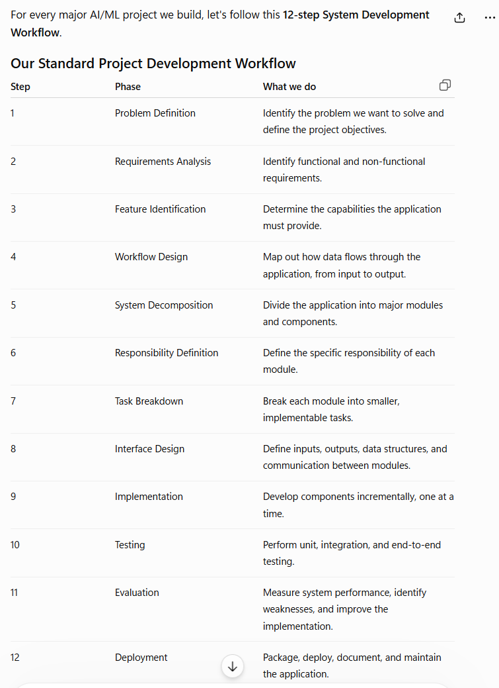
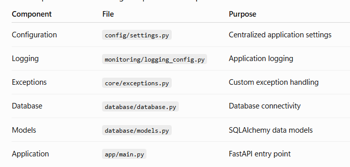
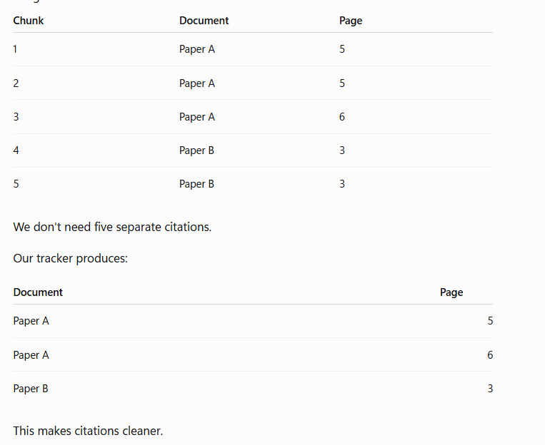

Define the project scope and requirement
Define the flow of the project. This project has 3 pipelines:
    1. Document Ingestion Pipeline
    ```text
             OpenAlex API
              |
              v
       Research Discovery
              |
              v
        PDF Acquisition
              |
              v
       Document Validation
              |
              v
        PDF Extraction
              |
              v
        Text Cleaning
              |
              v
       Document Chunking
              |
              v
       Embedding Generation
              |
              v
          ChromaDB
    ```
    2. Agestic RAG pipeline
    ```text
                 User Query
                 |
                 v
          Input Guardrails
                 |
                 v
          LangGraph Agent
                 |
                 v
          Intent Analysis
                 |
                 v
          Tool Selection
                 |
        +--------+---------+
        |        |         |
        v        v         v
    Document  Paper    Research
    Search   Compare    Analysis
        |        |         |
        +--------+---------+
                 |
                 v
          RAG Retrieval
                 |
                 v
          Context Assembly
                 |
                 v
          LLM Generation
                 |
                 v
          Output Guardrails
                 |
                 v
          Citation Validation
                 |
                 v
           Final Response
    ```
Create the project directory
Create a virtual environment and activate it
Create the project Structure
```textAI-Agent/
│
├── agent/
├── app/
├── config/
├── core/
│
├── database/
│
├── ingestion/
│
├── retrieval/
│
├── llm/
│
├── guardrails/
│
├── evaluation/
│
├── experiments/
│
├── monitoring/
│
├── scripts/
│
├── tests/
│   ├── unit/
│   ├── integration/
│   └── evaluation/
│
├── data/
│   ├── raw/
│   └── processed/
│
├── requirements.txt
├── .env
├── .env.example
├── .gitignore
└── README.md
```



- This is the procedure that we will follow to create any AI/ML project.

- We create the architecture and install the dependencies in the project environment.
- We do that by entering all the required libraries in requirements.txt and install that.
- Now we have our architecture and the libraries installed. 
- Now First Step will be to create an **Application Foundation.**
- Our goal was to implement the following components in this sequence:



- We create this universal config file because we do not want to hardcode every setting multiple times whereever we will need them. We will define them once and we will use it. We do that using `Pydantic Settings`.
- In settings file we are creating a dataclass where we are storing the default values of the settings that must be ex: the model for embeddings transformation that we will be using.
- Then we implement logging system on this where we will log in defined structure.
- Then we test our first two components by creating a unit test file in `test/unit/test_settings.py` and `test/unit/test_logging.py`.
- We run the test and our first checkpoint is complete. Then we will place a commit to git.

### Now we move to second layer:
- One thing to remember, our sqlite will only store the document metadata, the original document's embeddings will be stored in chromadb.
- We create the database files in the database folder. This is the purpose of modularity so that all the files don't mix up.
- Then we will create a unit test and test it.
- Now we have created a working session engine for our database.
- Now we will create the table schema
- Then we test the document_model.py as a unit test
- Now we will create a repository for SQL database queries to fetch the documents metadata from the table. We do this because we do not want our sql queries to be scattered all around the application.
- We usually need SQL to converse with the database but here we will use SQLAlchemy's orm.
- Then we test the database table creation using a unit test.

### Now we move to Research Discovery engine:
- In this module we integrate OpenAlex and make our application capable of discovering academic papers automatically.
- For this we will use the OpenAlex's `works api`.
- Now as we choose modularity we will create a client for our OpenAlex api so that we dont have to make HTTP requests directly from our discovery service.
- Now we define our client operations.
- Then We test it as a unit test.
- Now Our Client is created.
- Now we will implement the functionality of `Metadata Normalization`.
- We do this because OpenAlex provides us with JSON responses but our SQLite requires data in structured fields. We implement this transformation layer now.
- In this file we first implement the abstract reconstruction.
- Then we implement the normalization functions and we test them using a unit test.
- Then we define the discovery_service where we use the previously defined function to fetch the new research documents from OpenAlex and get the metadata as output in structured format.
- Now we have a metadata as an output of above layer which we have to insert into the database. 
- So we will now connect the the discovery_service to database layer.
- Now our goal is to save the discovered research papers into SQLite while preventing the duplicate entries.
- First method will be to detect duplicate entry and then we will implement the discover and persist method.
- We then test this using a unit test.
- Then we perform the integration testing of both the layers to check if they are working in harmony.
- We create a test file in integration folder this time.
- Test passes and this phase is complete.

### Now we move to the Document Ingestion layer. 
- Goal is to take an academic PDF and transform it into searchable knowledge.
- Now first task is to build a component that can open an academic PDF and extract its basic metadata and page-level text.
- We implement that and then we write a unit test for that.
- Now we need to make it robust enough to handle invalid user uploads. We edit the first file and write some more tests and test those units.
- Now that we defined the function to extract text, we will now focus on preparing a consistent document representation that downstream components can consume. And ultimate the output of this file look like:
```text
{
    "document_id": "uuid",
    "metadata": {
        "title": "Research Paper",
        "author": "Author Name",
        "total_pages": 10
    },
    "pages": [
        {
            "page_number": 1,
            "text": "Extracted page content..."
        }
    ]
}
```
- Now we have the pages and text for that pages. Now we need to clean the unwanted formatting of the pdfs that is present in the extracted text.
- We write `ingestion/preprocessing.py`.
- We test it.
- Now we will chunk the cleaned data so that it can be converted into embeddings and stored in chromabd. 
- We will preform chunking with some overlap.
- We implement chunking in `ingestion/chunking.py` and then we create tests for that.
- Now we create embeddings for those chunks.
- We will use `sentence-transformers` for that.
- We will implement the embedding generator.
- We test it as a unit test.
- Then to test its actual performance we will write a script in `scripts` folder to test the embeddings_generator and test them.
- Now we implement chromadb integration. Then embedding vectors will now be stored in chromadb.
- We are creating embedding vectors of 384 dimensions.
- Before we write chromadb code we will first create `retrieval/vector_store.py`. We do this because Chromadb will eventually support both ingestion and retrieval. Its better to have a reusable vector-store component rather than tightly coupling it to PDF processing.
- We then test it as unit test.
- Now we integrate the Chromadb.
- We create the `ingestion_service.py`.
- Now we wont test this as a unit test. We will combine the entire pipeline and test this as an integration test.
- THat is end of this phase.

### Now we move to the RAG implement phase.
- First we will implement the query encoder. As to perform the cosine similarity between vectors to get relevant information we will have the query in vector format.
- We are going to use the same embedding_generator that we created initially while processing the pdfs.
- Implement query encoder and test it.
- Then we will verify the query encoder using a script `scripts/test_query_encoder.py`.
- Now we implement the vector similarity search.
- Our goal to is retrieve the vectors that have similarity with our query encoded embedding vector.
- We test this using unit test.
- Now we get all the vectors that are related from the database to the query.
- NOw we will implement metadata based filtering. We do this to get the actual relevant data based on the query. In a database of 100 pages when a user asks `Give me information about document_id=78.`. We must be able to restrict the search to that particular paper even if 100 papers have similarity with the query.
- Write it and test it.
- FOr that we update the chromadb query and add filters in it.
- Now we implement the `top-k retrieval` where we would want the top 5 or the top n papers that have the most similarity score.
- Define it and test it.
- Now we have the top n chunks's embedding vectors that we got from the database.
- Create A context assembler.
- This returns us something like below as output:
```text
Consider two retrived chunks as:
retrieved_chunks = [
    {
        "text": "Machine learning improves medical diagnosis.",
        "metadata": {
            "title": "AI in Healthcare",
            "page_number": 5
        }
    },
    {
        "text": "Deep learning models can identify abnormalities.",
        "metadata": {
            "title": "Deep Learning Applications",
            "page_number": 12
        }
    }
]


Our Assembler will convert that into:
--- Source 1 ---
Document: AI in Healthcare
Page: 5
Content:
Machine learning improves medical diagnosis.

--- Source 2 ---
Document: Deep Learning Applications
Page: 12
Content:
Deep learning models can identify abnormalities.
```
- Then we create unit tests.
- Now we implement Source Tracker and Page Tacking.
- Each retrieved trunk now contains metadata as:
```text
{
    "document_id": "document-001",
    "chunk_index": 3,
    "page_number": 5,
    "title": "AI in Healthcare",
    "source_path": "data/raw/research_paper.pdf"
}
```
- The reason for doing this is:



- Notice Same Paper and page has multiple citations. We dont want to repeat the source multiple times. So we do this.
- We test it using Unit test.
- Now we will evaluate our retrieval and check how we performed.
- We will create precision@k, recall@k and MRR. We will test them.
- At this point the RAG Retrival Engine is complete.


